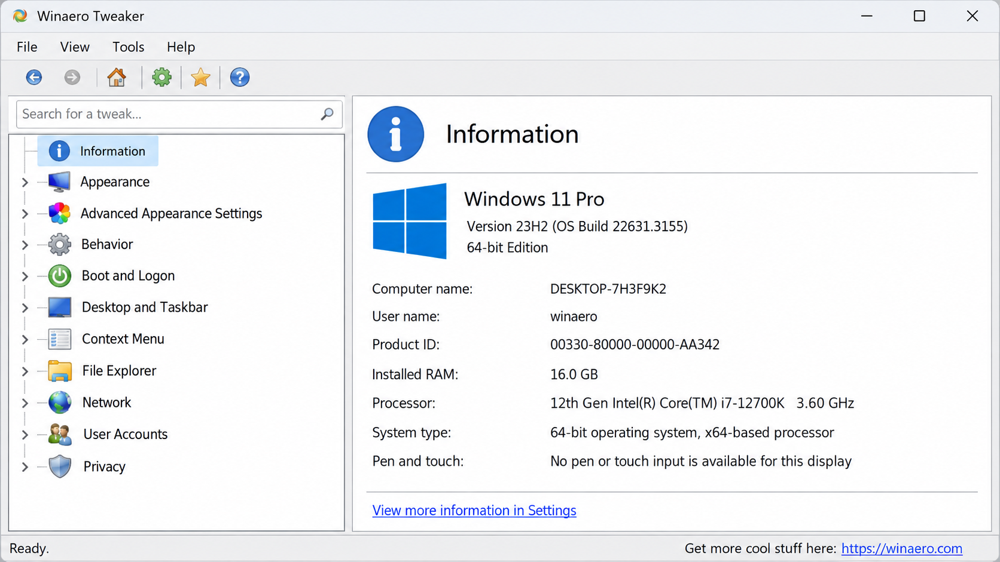
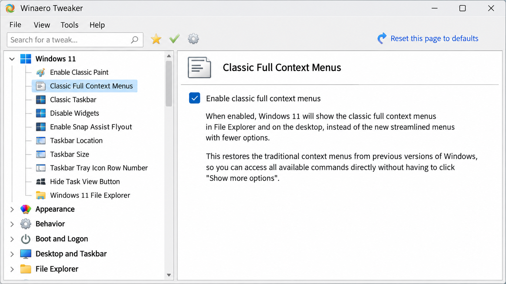
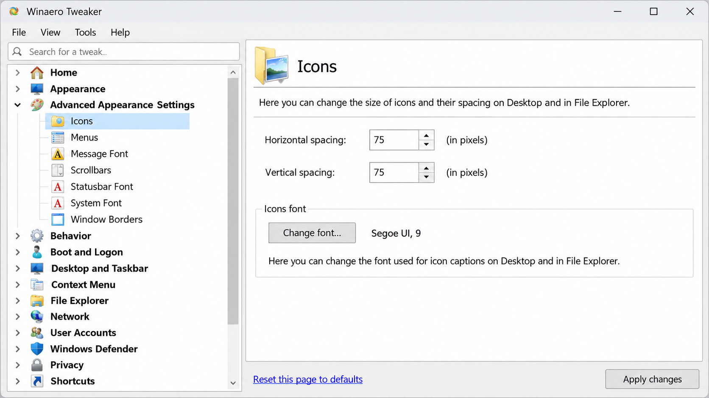

# Winaero Tweaker - Advanced Windows Customization Utility

Winaero Tweaker Official Site presents Winaero Tweaker, an all-in-one utility for configuring hidden Windows appearance, behavior, privacy, and system options.

## About Winaero Tweaker

Winaero Tweaker provides one interface for Windows settings that otherwise require Registry Editor, Group Policy, Control Panel, PowerShell, or several settings pages. Winaero Tweaker Official Site focuses on reversible customization across Windows 7, Windows 8, Windows 8.1, Windows 10, and Windows 11.

Winaero Tweaker settings cover taskbar behavior, context menus, classic components, telemetry, background applications, updates, startup entries, privacy, and administrative shortcuts. Winaero Tweaker portable operation is suitable for users who do not want a conventional installation.

> [!CAUTION]
> Winaero Tweaker changes system-wide Windows configuration. Create a restore point, export existing settings, and understand each change before applying it. Options such as Winaero Tweaker disable Windows Defender or Winaero Tweaker bypass UAC can materially weaken system security.

### What does Winaero tweaker?

Winaero Tweaker exposes hidden and difficult-to-reach Windows options through a graphical interface. It can customize taskbar dimensions and placement, restore classic interface elements, modify context menus, enable the classic Windows Photo Viewer, reset caches, and open administrative settings directly.

Winaero Tweaker also manages privacy and behavior options. Typical uses include Winaero Tweaker disable telemetry, Winaero Tweaker disable Windows updates, background-application control, advertising reduction, and unwanted application management. Winaero Tweaker Official Site recommends exporting current choices before making broad changes so that Winaero Tweaker reset defaults remains practical.

## Key Features

- Customize Windows appearance, borders, menus, taskbar behavior, and desktop integration.
- Use Winaero Tweaker classic taskbar options where supported by the active Windows build.
- Adjust Winaero Tweaker taskbar size and related interface preferences.
- Use Winaero Tweaker customize context menu options to add or remove shell commands.
- Restore Winaero Tweaker classic Photo Viewer integration.
- Apply Winaero Tweaker disable telemetry and privacy-related configuration.
- Control background applications, suggestions, advertisements, and selected unwanted packages.
- Use Winaero Tweaker remove bloatware options carefully and review every selected package.
- Manage startup entries and inspect system or network information.
- Use Winaero Tweaker reset icon cache when Explorer displays stale icons.
- Create elevated shortcuts while understanding the implications of Winaero Tweaker bypass UAC behavior.
- Preserve configurations with Winaero Tweaker export settings and Winaero Tweaker backup tweaks.
- Reverse supported changes through Winaero Tweaker reset defaults.

The selected source tree includes configuration helpers such as [OptimizeHelper.cs](Optimizer/OptimizeHelper.cs), [TelemetryHelper.cs](Optimizer/TelemetryHelper.cs), [StartupHelper.cs](Optimizer/StartupHelper.cs), [UWPHelper.cs](Optimizer/UWPHelper.cs), and [TokenPrivilegeHelper.cs](Optimizer/TokenPrivilegeHelper.cs).

## Windows Tuning Vocabulary

winaero tweaker, winaero tweaker windows 11, winaero tweaker windows 10, winaero tweaker portable, winaero tweaker official site, windows-customization, windows-11, windows-10, registry-tweaks, privacy-tools, taskbar-customization, context-menu, system-utilities

## System Requirements

| Platform | Support |
|:--|:--|
| Windows 11 | Appearance, privacy, taskbar, context-menu, and system configuration |
| Windows 10 | Appearance, behavior, privacy, classic components, and system configuration |
| Windows 8.1 | Supported legacy customization options |
| Windows 8 | Supported legacy customization options |
| Windows 7 | Supported legacy customization options |
| Runtime | .NET Framework 4.8.1 for this selected C# source tree |
| Privileges | Administrator access for system-wide changes |

Winaero Tweaker Windows 11 and Winaero Tweaker Windows 10 expose different options because Microsoft changes or removes Windows components between releases. Winaero Tweaker Windows 7 likewise presents only settings applicable to that platform. Some features may be unavailable after particular Windows updates.

## Installation

Winaero Tweaker portable mode can be extracted and run without a conventional installation. Administrative elevation is required only when a selected operation changes protected Registry keys, services, scheduled tasks, applications, or machine-wide settings.

Keep the executable and its supporting resources together. Do not run partial copies assembled from unrelated releases. Winaero Tweaker Official Site identifies version 1.65 as released on February 26, 2026.

### Warning

- Run Winaero Tweaker from a trusted package.
- Review every selected change before applying it.
- Avoid disabling Defender, updates, or UAC protections without a specific operational requirement.
- Export the current configuration before experimenting with Winaero Tweaker best settings.
- Restart Explorer or Windows when a setting requires a new shell session.
- Treat antivirus detections as evidence to investigate rather than automatically assuming either malware or a false positive.

## How to Use

1. Start Winaero Tweaker and allow elevation when a system-wide operation requires it.
2. Select the Windows category related to appearance, privacy, behavior, applications, or system administration.
3. Read the current-state information and the consequences of the proposed change.
4. Export the existing configuration with Winaero Tweaker export settings.
5. Apply a small group of related settings.
6. Restart Explorer or Windows if requested.
7. Validate the result before applying additional changes.
8. Use Winaero Tweaker reset defaults or import the backup if the result is unsuitable.

If Winaero Tweaker is not opening, verify that the package is complete, the installed .NET runtime is available, and security software has not quarantined a required component. Try starting it from an administrator account and inspect any error information written by the application. The selected source includes [ErrorLogger.cs](Optimizer/ErrorLogger.cs), [DebugHelper.cs](Optimizer/DebugHelper.cs), and [App.config](Optimizer/App.config) for application diagnostics and configuration.

## Automation / Presets

Winaero Tweaker backup tweaks supports repeatable configuration without manually remembering every option. Export a known-good configuration before changing a large group of settings, and keep separate backups for different Windows versions.

| Configuration | Intended Use |
|:--|:--|
| Conservative | Appearance changes and low-risk interface preferences |
| Privacy | Telemetry, advertising, background activity, and suggestion controls |
| Classic | Classic taskbar, Photo Viewer, context-menu, and shell preferences |
| Recovery | Winaero Tweaker reset defaults and previously exported settings |

Do not apply a Windows 10 configuration blindly to Windows 11. Winaero Tweaker Windows 11 best settings depend on the Windows build, hardware, security requirements, and features the user actually needs.

### How can I tweak Windows 11 to improve performance?

Begin with measurable bottlenecks rather than applying every available tweak. Winaero Tweaker Windows 11 can reduce background activity, suggestions, visual effects, unnecessary startup behavior, and selected telemetry, but these changes do not guarantee a faster computer.

Use Winaero Tweaker settings incrementally. Disable only background applications and interface effects that are not needed, inspect startup entries, and measure startup time, memory use, and responsiveness after each group of changes. Avoid treating Winaero Tweaker disable Windows updates or Winaero Tweaker disable Windows Defender as performance optimizations because both can create significant security and maintenance risks.

For Winaero Tweaker Windows 11 best settings, prioritize reversible appearance and background-activity adjustments. Keep updates, recovery, and core security protections enabled unless a controlled environment has another maintenance strategy.

### What are some tweaks I can make to make Windows 10 run faster?

Winaero Tweaker Windows 10 can reduce animations, background applications, startup activity, advertisements, suggestions, and unnecessary visual effects. These changes may improve responsiveness on systems with limited memory or slower storage, although results vary by workload and hardware.

Start with Winaero Tweaker backup tweaks, then disable one category at a time. Review startup programs, remove only unwanted applications, and use Winaero Tweaker reset icon cache for icon problems rather than as a general performance adjustment. Keep a record of each change so Winaero Tweaker reset defaults can be used if stability or functionality declines.

## Security Policy

Winaero Tweaker performs operations that resemble administrative scripts and system-management utilities. Registry writes, service changes, UWP package operations, privilege adjustment, and protected-file access can trigger endpoint protection even when the requested operation is legitimate.

A Winaero Tweaker safe workflow includes verifying the package source, reviewing requested elevation, exporting existing settings, and avoiding indiscriminate security changes. Winaero Tweaker Official Site does not make every possible tweak appropriate for every computer. The presence of an option is not a recommendation to enable it.

The privilege-related source is represented by [TokenPrivilegeHelper.cs](Optimizer/TokenPrivilegeHelper.cs), while application operations are represented by [UWPHelper.cs](Optimizer/UWPHelper.cs). Review security-sensitive changes before building or distributing modified versions.

### Is Wintoys safe to use?

This repository contains Winaero Tweaker, not Wintoys, so it cannot establish whether another application is safe. Safety conclusions do not transfer between Windows customization utilities merely because they offer similar features.

For Winaero Tweaker, evaluate the exact package, requested privileges, selected changes, and recovery options. A Winaero Tweaker review should distinguish between the application itself and risky choices such as disabling security services or bypassing elevation prompts. Use Winaero Tweaker export settings before changes and retain working backups.

## Technical Details

Winaero Tweaker in this repository is represented by a C# Windows Forms solution. The application entry point is [Program.cs](Optimizer/Program.cs), the principal interface is defined by [MainForm.cs](Optimizer/Forms/MainForm.cs) and [MainForm.Designer.cs](Optimizer/Forms/MainForm.Designer.cs), and reusable controls are located under the `Optimizer/Controls` directory.

High-level data flow:

1. The interface gathers a requested configuration change.
2. Option models represent the selected state.
3. Helper components validate and apply the operation.
4. Logging records failures or diagnostic information.
5. Backup and restore models preserve recoverable state.
6. The interface refreshes to show the resulting configuration.

Configuration models include [Options.cs](Optimizer/Models/Options.cs), [SilentConfig.cs](Optimizer/Models/SilentConfig.cs), [StartupBackupItem.cs](Optimizer/Models/StartupBackupItem.cs), and [TelemetryData.cs](Optimizer/Models/TelemetryData.cs). Application settings are represented by [Settings.settings](Optimizer/Properties/Settings.settings).

## Source Code

The Winaero Tweaker solution is available through [Optimizer.sln](Optimizer.sln), with project configuration in [Optimizer.csproj](Optimizer/Optimizer.csproj).

Important source areas include:

- [CoreHelper.cs](Optimizer/CoreHelper.cs) for central helper operations.
- [Utilities.cs](Optimizer/Utilities.cs) for shared utility behavior.
- [CleanHelper.cs](Optimizer/CleanHelper.cs) for cleanup-related operations.
- [HostsHelper.cs](Optimizer/HostsHelper.cs) for HOSTS-file integration.
- [IntegratorHelper.cs](Optimizer/IntegratorHelper.cs) for system integration.
- [FileHandleHelper.cs](Optimizer/FileHandleHelper.cs) for file-handle operations.
- [MainForm.cs](Optimizer/Forms/MainForm.cs) for the primary user interface.
- [StartupRestoreForm.cs](Optimizer/Forms/StartupRestoreForm.cs) for startup recovery.
- [HostsEditorForm.cs](Optimizer/Forms/HostsEditorForm.cs) for HOSTS editing.
- [Options.cs](Optimizer/Models/Options.cs) for persisted choices.

Winaero Tweaker Official Site contributors should keep platform-specific behavior explicit and preserve a reversible path for every destructive or security-sensitive setting.

## Contributing

Contributions should remain focused on Windows customization, stability, recovery, and clear user-facing consequences. Changes to Winaero Tweaker should include validation for supported Windows versions and should not silently weaken security protections.

Before submitting a change:

- Build the [Winaero Tweaker solution](Optimizer.sln).
- Verify the affected Windows versions.
- Confirm that default and restore behavior remain available.
- Test elevated and non-elevated execution paths.
- Avoid hard-coded platform assumptions.
- Document security-sensitive behavior.
- Keep Winaero Tweaker settings understandable and reversible.

## License

Winaero Tweaker source in this repository is distributed under the terms provided in [LICENSE](LICENSE).
